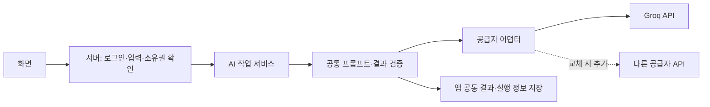

# Careermap AI 연동 설계

상태: 구현 전 설계안. 작성일: 2026-10-11. 연결·호출·한국어 품질 테스트는 아직 수행하지 않았다.

## 1. 결정

초기부터 무료 제공량이 있는 API로 개발한다. ChatGPT 구독 연동을 기본 경로로 두지 않는다. 초기 평가 후보는 Groq Free의 프로덕션 모델 `openai/gpt-oss-120b`다. 실제 계정에서 모델 사용과 한도, 한국어 결과를 확인한 뒤 고정한다.

공급자와 모델을 바꿀 때 화면·경험 데이터·문서 저장 구조를 다시 설계하지 않도록 앱 공통 작업과 공급자 연동을 분리한다. 다른 공급자에 대한 API 호환성, 지원 기능, 프롬프트 품질 검증은 교체 시 필요하다.

## 2. 초기 공급자 평가 근거

| 항목 | 2026-10-11 공식 문서에서 확인한 내용 |
|---|---|
| 무료 이용 | Groq Free 플랜 한도 표 존재. 업그레이드는 별도의 결제 수단 등록 단계 |
| 텍스트 모델 | `openai/gpt-oss-120b`가 프로덕션 모델로 표시됨 |
| 호환성 | OpenAI 클라이언트 라이브러리와 대부분 호환. 모든 파라미터·기능이 같지는 않음 |
| 무료 한도 예시 | 해당 모델 표는 RPM 30, RPD 1,000, TPM 8,000, TPD 200,000을 안내. 조직 전체 기준이며 실제 계정 설정이 우선 |
| 데이터 | 추론 입력·출력은 기본적으로 보관하지 않지만 장애·남용 조사 등 예외가 있음. 모든 고객에게 ZDR 설정을 안내 |

무료 한도 때문에 한 번의 요청에 이력서 전체·모든 프로젝트·전체 면접 이력을 항상 넣지 않는다. 요청 크기와 실제 과금/추론 토큰 산정은 응답·계정 한도를 확인해 조절한다.

Gemini API도 무료 후보이나, 무료 약관은 제품 개선을 위한 입력·출력 사용 및 개인·민감·기밀 정보 제출 제한을 안내한다. 실제 이력서·경력정보가 중심인 초기 공급자는 Groq를 먼저 평가한다. Groq 사용에도 개인 연락처 제외와 데이터 보관 설정 확인은 필요하다.

## 3. 연결 구조

키는 서버에서만 읽는다. 화면은 공급자 URL·SDK·API 키에 의존하지 않는다. UI에서 보내는 작업은 임의의 공급자 호출이 아니라 허용된 Careermap 작업 유형이다.

## 4. 앱 공통 작업과 결과

| 작업 | 입력 | 검증할 결과 |
|---|---|---|
| 경험 구조화 | 사용자 경험·목표 직무 | 역할·행동·결과·근거·추가 질문 |
| 자기분석 | 선택한 프로필·경험 | SWOT·근거 경험·추가 질문 |
| 기업·공고 분석 | 사용자 등록 자료·공고·출처 | 요구 역량·출처·미확인 항목 |
| 맞춤 분석 | 요구 역량·관련 경험 | 연결 근거·보완 항목·준비 과제 |
| 이력서·자소서 제안 | 선택한 경험·공고·문항·초안 | 제안 본문·변경점·참조 경험 |
| 면접 질문·피드백 | 제출본·경험·질문·답변 | 예상 질문·추가 질문·근거 있는 피드백 |

공통 응답에는 작업 유형, 앱 결과 형식 버전, 처리 상태, 결과, 입력 자료의 버전, 실행 식별자를 둔다. 실행 정보는 공급자·모델·프롬프트 버전·토큰 사용량·처리 시간을 포함한다. 공급자의 원시 응답을 그대로 문서 데이터 모델로 사용하지 않는다.

AI가 반환한 경험 ID·자료 ID는 전달한 자료에 실제 존재하는지 확인한다. JSON 등 구조화 결과는 서버에서 검증한다. 공급자가 지원하는 JSON 기능을 활용할 수 있지만 이를 사용했다는 이유로 결과 검증을 생략하지 않는다.

## 5. 설정과 교체

초기 서버 설정:

| 설정 | 초기 값·역할 |
|---|---|
| `CAREERMAP_AI_PROVIDER` | `groq` |
| `CAREERMAP_AI_MODEL` | `openai/gpt-oss-120b` |
| `GROQ_API_KEY` | 환경의 비밀 설정으로 주입. 값은 문서·코드·로그에 저장하지 않음 |

작업별로 모델과 프롬프트를 바꿀 수 있게 한다. 공급자 URL은 서버의 검증된 설정만 사용하며 사용자 입력 URL로 인증정보를 보내지 않는다.

같은 공급자의 모델 변경은 설정으로 처리한다. 다른 공급자 변경은 해당 어댑터와 키를 추가하고 공통 결과·오류 매핑을 검증한다. 기반 데이터는 유지한다. 모든 모델의 한국어 품질과 구조화 출력이 동일하다고 가정하지 않는다.

## 6. 무료 한도와 실패 처리

- 한도는 공급자 조직 전체와 앱 사용자별로 관리한다. 사용자별 제한만 두고 공급자 전체 제한을 무시하지 않는다.
- 긴 입력은 전체를 조용히 잘라 보내지 않고 관련 경험 선택·분량 조정을 요청한다.
- `429`는 제공된 대기 시간을 활용해 제한된 재시도를 하고, 무한 반복하지 않는다. 일일 한도 소진은 다음 이용 가능 시점을 안내한다.
- 인증 실패·지원하지 않는 모델·공급자 장애·형식 오류를 구분한다.
- 실패해도 초안과 사용자 답변을 보존한다. 실패·부분 응답을 완료된 분석으로 저장하지 않는다.
- 무료 한도 소진 시 자동으로 유료 호출하거나 다른 공급자에 재전송하지 않는다.
- 동일 기업·공고 버전의 공통 분석은 재사용하되, 개인 경험이 포함된 결과는 다른 사용자에게 공유하지 않는다.
- 모델 교체 이후 결과를 새 실행 버전으로 저장하고 기존 제출본·완료 연습·게시본을 유지한다.

## 7. 키 준비와 실제 연동 검증

현재 환경에서 `GROQ_API_KEY` 및 관련 후보 키의 존재 여부와 환경 설정의 자격증명 메타데이터를 확인했으며 사용 가능한 키는 없었다. 값을 출력하거나 요청하지 않았다.

필요한 자격증명은 `GROQ_API_KEY`이고 HTTPS 대상은 `api.groq.com`이다. 사용자가 Groq Free 계정을 준비해 환경 설정의 비밀 입력에 키를 등록해야 실제 호출 검증이 가능하다. 채팅에 값을 붙여 넣지 않는다.

키 준비 후 구현 단계에서 검증할 항목:

1. 실제 계정의 무료 플랜·모델 접근·한도를 확인한다.
2. 합성 경험·합성 공고로 한국어 경험 정리와 자소서 제안 작업을 실제 호출한다.
3. 구조화 출력과 참조 ID 검증, 사실 추가 여부, 토큰·한도를 확인한다.
4. 텍스트 면접의 답변 기반 후속 질문과 피드백을 검증한다.
5. 입력 보존, 한도 소진·오류 처리, 계정 간 접근 범위를 확인한다.

실제 사용자 자료를 전송하기 전 계정의 데이터 보관 옵션을 확인한다. 키 등록만으로 앱 구현·호출 검증·품질 검증이 완료된 것은 아니다.

## 8. 공식 자료

- Groq 무료 플랜 한도: https://console.groq.com/docs/rate-limits
- Groq 모델: https://console.groq.com/docs/models
- Groq OpenAI 호환 범위: https://console.groq.com/docs/openai
- Groq 결제·플랜: https://console.groq.com/docs/billing-faqs
- Groq 데이터 정책: https://console.groq.com/docs/your-data
- Groq API 키 설정: https://console.groq.com/keys
- Gemini 무료 가격: https://ai.google.dev/gemini-api/docs/pricing
- Gemini 이용 조건: https://ai.google.dev/gemini-api/terms

## 구현 검증 기록 (2026-10-11)

초기 웹 MVP에서 서버 전용 Groq 어댑터를 연결했다. 실제 모델 목록 조회와 앱 `/api/ai`를 통한 `company` 요청을 검증했다. HTTP 200, `openai/gpt-oss-120b`, 한국어 분석 1,854자, 총 1,622토큰 응답을 확인했다. 무료 플랜 자체와 모든 계정 한도를 API 응답으로 확인한 것은 아니다.

클라우드에서는 Node 24의 `NODE_USE_ENV_PROXY=1`과 앱 User-Agent를 사용한다. 기본 Python User-Agent의 모델 목록 요청은 Cloudflare 403을 받았지만, 앱 User-Agent를 사용한 요청은 성공했다. 환경에 공급자 키가 주입되어 있으며 값은 저장소와 클라이언트 번들에 넣지 않는다.

UI는 첫 AI 요청 전에 외부 전송 자료를 안내하고, 결과는 검토 후 반영한다. 비공개 메모는 AI 문맥에서 제외한다. 면접 작업은 제출본이 있으면 제출 당시 공고와 프로젝트 스냅샷을 사용한다. 요청 제한과 공급자 오류를 처리하고, 실패해도 작성한 서류를 유지한다.

추가로 운영 모드에서 `cover`와 `questions`를 실제 API 호출로 확인했다. 예상 질문은 지정한 제목 형식으로 5개가 생성되었다. 자소서는 초기 응답이 제한을 넘는 문제가 있어 본문만 출력하고 제한보다 짧은 분량을 목표로 하도록 프롬프트를 수정했으며, 700자 제한에서 571자 응답을 확인했다. 모델의 글자수 준수를 보장하지 않으므로 결과 검토 화면에서도 글자수를 표시하고, 편집기의 제출본 확정은 제한 초과 시 막는다. AI의 사실 정확성은 사용자가 원본 경험과 대조해 검토해야 한다.

학력과 기업 문화·가치 추정을 명시적으로 제한한 최종 프롬프트에서는 700자 제한 내 484자 응답을 확인했다. 다만 검토 중 기업 비전·개인 가치관을 추정하는 표현이나 기간을 부정확하게 풀어 쓰는 경우도 확인했다. 호출 성공·형식·분량 검증은 사실 정확성 보장이 아니다. 결과 화면은 경험·수치·기간·기업 정보를 확인하도록 안내하며, 외부 출시 전 직무별 한국어 품질 평가와 근거 검증을 추가해야 한다.
