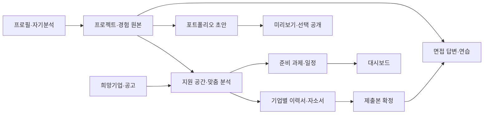

# Careermap 제품 요구사항 문서

| 항목 | 내용 |
|---|---|
| 버전 | v0.3 |
| 작성일 | 2026-10-11, 한국 시간 |
| 상태 | 기획 초안 — 구현 전 |
| 제품명 | Careermap, 가칭 |
| 대상 | 신입 취업 준비생 및 경력 이직 준비자 |
| 제품 형태 | 개인 커리어 준비 웹 서비스 |
| 디자인 방향 | 차분하고 전문적이며, 준비 상태와 다음 행동이 명확한 화면 |

이 문서는 지금까지 합의한 제품 방향을 요구사항으로 정리한다. 첫 출시의 세부 범위·출시 기준·지표는 실행 가능한 기본안으로 제안하며, 실제 구현 일정이나 사업 성과를 확정한 문서가 아니다. 초기부터 무료 제공량이 있는 서버 측 AI API를 사용하고, 같은 연결 구조에서 유료 플랜·다른 모델·공급자로 전환한다. 초기 평가 후보는 Groq Free의 `openai/gpt-oss-120b`이며 실제 계정 한도·한국어 품질·연동은 별도 검증한다. 기술 스택, 공고 데이터 계약, 과금 정책은 미결정이다.

## 1. 제품 정의

**Careermap은 사용자의 프로젝트와 경험을 기반으로, 희망 기업·공고별 취업 및 이직 준비를 관리하고 서류·면접·포트폴리오로 연결하는 개인 커리어 워크스페이스다.**

사용자는 경험을 한 번 정리하고, 지원처에 맞는 강조점을 선택해 결과물을 만든다. 기업별로 무엇을 준비했고 무엇이 남았는지 확인하며, 실제 제출한 서류를 기준으로 면접을 준비한다. 선택한 프로젝트는 나만의 공개 포트폴리오 사이트로 구성한다.

핵심 연결 구조:

> 사용자 프로필·자기분석 → 프로젝트·경험 기록 → 희망 기업·공고 → 맞춤 분석·준비 로드맵 → 기업별 서류 → 제출본 기반 면접 준비·연습 → 공개 포트폴리오

각 기능은 독립적으로 시작할 수도 있다. 희망 기업이나 공고가 없더라도 경험 정리, 기본 이력서, 자기분석, 포트폴리오 작성을 사용할 수 있어야 한다.

## 2. 해결할 문제와 목표

### 2.1 문제 정의

아래는 사용자 대화와 경쟁사 조사에서 도출한 문제 가설이다. 사용자 조사로 빈도와 중요도를 검증해야 한다.

| 문제 | 제품이 제공할 변화 |
|---|---|
| 프로젝트·활동·경력 기록이 흩어져 있어 지원할 때마다 다시 정리함 | 경험의 원본을 한곳에 저장하고 여러 결과물에서 재사용 |
| 기업정보를 읽어도 나의 경험과 어떻게 연결할지 어려움 | 공고 요구 역량과 경험의 근거를 연결하고 준비 과제를 제안 |
| 여러 기업의 서류와 수정본을 구분하기 어려움 | 기업·공고별 초안, 수정 이력, 제출본 관리 |
| 서류 작성과 면접 준비가 분리됨 | 실제 제출본과 관련 경험에서 면접 질문·답변을 준비 |
| 포트폴리오 사이트 제작을 위해 내용을 다시 입력해야 함 | 기록한 프로젝트를 선택해 사이트 구성 및 공개 |
| 기능이 많아도 다음에 할 일을 알기 어려움 | 관심 공고의 일정·준비 과제·진행 상태를 보여주는 대시보드 |

### 2.2 제품 목표

1. 하나의 실제 경험이 서류, 면접 답변, 포트폴리오까지 연결되게 한다.
2. 기업·공고별 준비 과정과 실제 제출 내용을 명확하게 관리한다.
3. 신입/경력, 전공·경험 배경, 목표 직무에 맞는 질문과 작성 구성을 제공한다.
4. 분석 결과를 실행할 수 있는 준비 과제로 바꾼다.
5. 사용자의 기록과 AI 제안을 구분하고, 사용자가 최종 결과물을 통제하게 한다.

### 2.3 경쟁력 가설

나임·하이잡은 경험과 서류·면접의 연결을, Teal은 지원 관리 워크스페이스를, Kickresume·Cake는 커리어 맵 또는 개인 사이트·포트폴리오를 이미 안내한다. 기능 통합이나 경험 재사용 자체를 독자 기능으로 주장하지 않는다.

Careermap은 **프로젝트의 구체적인 근거, 기업별 준비 과제, 결과물 간 연결, 버전 관리, 편한 사용 흐름**의 완성도로 차이를 검증한다. 사용자가 느낀 나임의 UI 불편은 개인 사용 경험이며, 프로젝트 정리·사이트 제작 기능의 부재를 확정한 근거는 아니다.

조사 근거: [경쟁사 분석 문서](../../research/competitor-analysis-2026-10-11.md). 이 상대 경로는 현재 워크스페이스의 조사 자료를 가리킨다. 대표 공식 자료는 문서 마지막에 별도로 수록한다.

## 3. 사용자와 맞춤화

### 3.1 대표 사용자 시나리오

| 사용자 | 주요 상황 | 필요한 지원 |
|---|---|---|
| 신입 취업 준비생 | 팀 프로젝트·학업·활동은 있지만 직무 역량으로 설명하기 어려움 | 경험 발굴, 기여 구분, 직무별 표현, 기본 서류와 포트폴리오 |
| 경력 이직 준비자 | 경력은 있지만 성과·전문성 정리와 기업별 서류 관리가 필요함 | 경력기술서, 성과 근거, 이직 동기, 지원처별 버전 및 면접 준비 |
| 목표 직무 탐색자 | 전공과 희망 직무가 다르거나 직무가 아직 미정임 | 경험 기반 직무 탐색과 목표 설정, 공고 없이 시작할 수 있는 흐름 |

위 유형은 제품 설계용 시나리오이며 실제 사용자 조사 결과로 간주하지 않는다.

### 3.2 최초 온보딩

| 정보 | 첫 진입 요구 | 사용 목적 |
|---|---|---|
| 준비 유형 | 신입 취업 / 경력 이직 / 아직 결정하지 못함 중 선택 | 시작 화면과 서류 안내 조정 |
| 전공·경험 배경 | 이공계 / 인문·사회계 / 예체능 / 융합·기타 / 미입력, 복수 선택 가능 | 경험 질문 및 예시 조정 |
| 목표 직무 | 복수 선택 또는 미정 | 분석·질문·포트폴리오 구성 조정 |
| 준비 상태 | 경험 정리 전 / 서류 준비 / 지원 중 / 면접 준비 | 초기 추천 할 일 구성 |

회원가입에는 최소한의 로그인 정보를 사용한다. 전공 세부 정보, 경력 기간, 역량, 희망 지역 등은 필요한 기능에서 점진적으로 받는다. 전화번호·생년월일은 초기 취업 준비 기능의 필수 입력으로 두지 않는다.

프로필은 언제든 수정할 수 있다. 목표 직무 변경은 기존 서류나 프로젝트를 삭제하거나 자동으로 덮어쓰지 않는다. 사용자가 목표를 정하지 않아도 경험 정리를 시작할 수 있다.

### 3.3 맞춤화 규칙

**목표 직무의 요구사항을 우선하고, 신입/경력과 실제 경험으로 보완하며, 전공 계열은 질문과 예시를 조정하는 참고 정보로 사용한다.** 전공으로 지원 가능 직무를 제한하지 않는다.

| 직무 예시 | 경험 정리의 추가 질문 | 결과물에서 강조할 내용 |
|---|---|---|
| 개발·데이터 | 기술 선택, 구조, 검증 방법, 성능·오류, 개인 기여 | 구현 판단과 측정 가능한 개선 |
| 연구·엔지니어링 | 가설, 실험·설계, 조건, 검증, 해석·한계 | 방법과 결과의 타당성 |
| 기획·마케팅 | 사용자·고객 문제, 조사, 전략, 실행, 지표 | 문제 정의와 실행 성과 |
| 영업·운영·인사 | 이해관계자, 협업, 프로세스, 개선, 조직 기여 | 조율 과정과 효율·성과 |
| 디자인·콘텐츠 | 대상, 제작 의도, 과정, 수정 근거, 결과물·반응 | 작업 과정과 판단 근거 |

공통 질문은 문제, 역할, 행동, 결과, 배운 점이다. 신입에게는 학업·활동·팀 프로젝트 예시를, 경력에게는 업무 범위·성과·협업·경력기술서 예시를 제공한다. 수치 성과가 없는 경험도 기록할 수 있다.

## 4. 제품 범위와 출시 단계

### 4.1 확정한 핵심 기능

1. 자기분석
2. 프로젝트·경험 정리
3. 기업분석
4. 희망기업 리스트와 맞춤형 분석
5. 이력서 작성
6. 자기소개서 작성
7. 면접 답변 준비
8. 면접 연습
9. 포트폴리오 생성 및 사이트 공개

공통 기반은 사용자 프로필, 저장·복구, 대시보드·준비 로드맵, 기업·공고별 버전 관리다.

### 4.2 첫 출시(P0)와 후속 확장(P1)

첫 공개 출시는 9개 핵심 기능의 최소 흐름을 끝까지 제공하되, 프로젝트 정리와 기업별 연결에 개발 깊이를 집중한다. 개인용 검증 단계부터 무료 API를 실제로 연결한다. 부분 개발 완료와 전체 공개 출시를 구분한다.

| 영역 | P0: 첫 출시 요구 | P1: 후속 후보 |
|---|---|---|
| 자기분석 | 경험 기반 강약점·SWOT, 목표와 준비 과제 | 정교한 직무 탐색·추가 진단 |
| 프로젝트·경험 | 직무별 작성 가이드, 성과·증빙, 결과물 연결 | 기존 문서 자동 추출·외부 도구 가져오기 |
| 기업분석 | 사용자 등록 자료와 출처를 바탕으로 기업·공고 분석 | 공시·뉴스의 자동 수집과 갱신 |
| 희망기업 | 기업·공고 직접 등록, 우선순위·일정·준비 상태, 경험 연결 | 자동 공고 추천·알림·외부 캘린더 연동 |
| 이력서·자소서 | 직접 편집, AI 제안, 공고별 버전, 제출본, 복사·이력서 PDF | 다양한 파일 가져오기·고급 양식·DOCX/HWP 출력 |
| 면접 답변 | 예상 질문·답변 저장·편집, 근거 경험·제출본 연결 | 질문별 세밀한 코칭과 추가 유형 |
| 면접 연습 | 텍스트 모의면접, 답변 기반 추가 질문, 피드백·기록 | 음성·영상·전사 기반 연습 |
| 포트폴리오 | 기본 템플릿, 프로젝트 선택·순서·공개 항목, 미리보기·공유 URL·공개 해제 | 추가 템플릿, 커스텀 도메인, 기업별 복수 사이트 |

### 4.3 첫 출시에서 제외할 범위

- 자체 채용 마켓·기업용 채용 관리·자동 지원 제출
- 외부 공고의 대규모 수집과 자동 추천
- 커뮤니티·현직자 멘토 매칭
- 음성·영상 면접 평가와 표정·성격 판정
- 합격 확률 예측, 직무 적합도를 확정하는 단일 점수
- 범용 자유 배치 웹사이트 빌더, 사용자 코드 삽입
- 유료 결제 및 기관용 관리자 기능

공고 추천은 기존에 논의한 제품 확장 방향으로 유지하지만 첫 출시의 필수 기능에서는 제외한다. 가격·수익 모델은 사용 가치와 운영 비용을 확인한 뒤 결정한다.

### 4.4 AI 이용 방식: 처음부터 무료 API 연결

최신 사용자 결정: 초기부터 무료 API를 사용한다. 이전 v0.2의 ChatGPT 구독 연동·복사/붙여넣기 방식은 기본 개발 경로에서 제외한다.

| 단계 | AI 이용 방식 | 완료 기준·제약 |
|---|---|---|
| 초기 개발·개인용 | Groq Free의 `openai/gpt-oss-120b`를 서버 측 어댑터로 연결하는 것을 초기 평가안으로 채택 | API 키, 실제 모델 접근, 계정별 한도, 한국어 결과·구조화 출력 검증 필요 |
| 공급자 교체·고도화 | 작업별 설정과 공급자 어댑터를 통해 모델·플랜을 변경 | 데이터·화면 구조를 유지하고 어댑터 호환성·프롬프트·품질을 다시 검증 |
| 공개 서비스 | 같은 API 구조에 사용자별 한도·사용량·비용·접근 범위 운영을 추가 | 무료 한도로 출시 규모를 감당할 수 있는지 확인하고 필요하면 유료 전환 |

무료 API는 한도 내 무료 이용을 뜻하며 무제한·영구 무료를 보장하지 않는다. 한도 도달 시 입력을 보존하고 대기·재시도를 안내한다. 자동 유료 업그레이드나 다른 공급자로의 자동 데이터 전송은 하지 않는다.

UI는 공급자 SDK를 직접 호출하지 않는다. 분석·문서 제안·질문·피드백의 공통 작업 계층과 공급자 어댑터를 분리한다. 공급자·모델·프롬프트 버전은 설정으로 관리하고 AI 결과에 실행 정보를 연결한다. 프로젝트·문서·제출본은 공급자별 응답 형식에 종속되지 않도록 저장한다.

API 키는 서버 측 비밀 설정에만 둔다. 개인의 연락처·계정 정보는 요청에서 제외하고 작업에 필요한 경험·공고만 전달한다. 실제 이용 전 공급자 데이터 정책·보관 설정을 확인한다. 상세 설계는 [AI 연동 설계](AI_INTEGRATION.md)에 정의한다.

## 5. 정보 구조와 핵심 화면

### 5.1 기본 내비게이션

| 메뉴 | 역할 |
|---|---|
| 대시보드 | 이번 주 할 일, 마감·면접 일정, 지원별 준비 진행률 |
| 자기분석 | 프로필, 역량·SWOT, 목표 설정 |
| 프로젝트·경험 | 프로젝트·활동·경력 원본과 증빙 |
| 희망기업 | 관심 기업, 공고별 지원 공간, 기업분석·맞춤 분석 |
| 서류 | 기본 이력서와 공고별 이력서·자소서·제출본 |
| 면접 | 질문·답변 라이브러리, 연습, 기록 |
| 포트폴리오 | 사이트 구성, 미리보기, 공개 관리 |

기업분석은 희망기업의 기업 상세에서, 이력서·자소서는 서류 메뉴에서 접근한다. 기능 수에 맞춰 같은 깊이의 메뉴를 무조건 늘리지 않는다.

### 5.2 기업과 공고의 분리

기업에는 공통 기업정보·분석·관심 메모를 저장한다. 실제 서류·면접·일정은 기업 아래 **공고별 지원 공간**에 저장한다. 같은 기업의 다른 직무·채용 회차는 별도의 지원 공간이다.

공고가 아직 없으면 기업만 저장할 수 있다. 사용자가 직무와 지원 계획을 직접 입력해 준비 공간을 만들 수 있으나, 공고가 없는 분석에는 그 한계를 표시한다.

지원 공간의 탭:

- 개요: 목표 직무, 마감, 지원 상태, 준비 과제
- 분석: 기업·공고 요구사항, 경험 연결, 보완할 부분
- 서류: 맞춤 이력서·자소서, 버전·제출본
- 면접: 예상 질문·답변, 제출본 기반 연습
- 관련 경험: 선택 프로젝트·경력과 증빙

## 6. 핵심 사용자 흐름

### 6.1 신입의 첫 지원 준비

1. 준비 유형·배경·목표 직무·준비 상태를 입력한다.
2. 프로젝트 또는 활동 한 건을 정리한다. 개인 역할을 팀 전체 성과와 구분한다.
3. 희망기업과 공고를 등록한다.
4. 요구 역량과 내 경험의 연결·보완 과제를 확인한다.
5. 공고별 이력서·자소서를 작성하고 검토한다.
6. 실제 지원에 사용할 제출본을 확정한다.
7. 제출본과 경험을 기반으로 면접 답변을 준비하고 연습한다.
8. 공개할 프로젝트를 골라 포트폴리오 사이트를 게시한다.

포트폴리오 게시 시점은 사용자가 정한다. 위 순서의 모든 단계를 강제하는 마법사 형태로 제한하지 않는다.

### 6.2 경력자의 여러 공고 관리

1. 경력·프로젝트·성과와 기본 이력서/경력기술서를 정리한다.
2. A기업과 B기업의 공고를 등록한다.
3. 같은 경험을 각 공고에서 다른 강조점으로 활용한다.
4. 공고별 문서를 독립적으로 수정하고 제출본을 보관한다.
5. 각 제출본에 맞춘 면접 답변과 연습기록을 관리한다.
6. 원본 경험을 수정하면 관련 작업 초안의 변경 알림을 받는다. 기존 제출본은 유지된다.

### 6.3 목표 직무가 미정인 사용자

경험 정리 → 자기분석 → 목표 후보·다음 탐색 과제 확인 → 목표 선택. 공고·기업 등록이나 AI 분석 완료를 경험 기록의 선행 조건으로 두지 않는다.

## 7. 기능별 요구사항과 수용 기준

모든 항목은 P0 기준이다. ‘AI 제안’은 사용자가 검토·편집·반영하는 초안으로 제공한다.

### ONB — 사용자 프로필과 온보딩

**요구사항**

- 최초 입력은 짧은 단계로 구성하고 미정·건너뛰기를 지원한다.
- 목표 직무와 신입/경력에 따라 초기 질문·예시·추천 과제를 조정한다.
- 변경 전후 기존 데이터는 유지하며, 이전 분석에 재검토가 필요하면 알린다.

**수용 기준**

- 목표 직무 미정과 배경 미입력으로도 프로젝트를 저장할 수 있다.
- 인문계 배경의 개발 지원자에게 개발 직무 질문을 제공한다.
- 프로필 수정 후 제출본과 공개 사이트는 자동으로 변경되지 않는다.

### SELF — 자기분석

**요구사항**

- 역량·강점·보완점을 직접 작성하거나 경험 기반 AI 제안으로 정리한다.
- SWOT는 강점/약점과 목표 직무·시장 맥락의 기회/위협을 구분한다.
- 각 제안에는 관련 경험·프로필·기업자료 또는 사용자 입력을 연결한다.
- 근거가 부족한 항목은 추가 질문으로 남기고, 준비 과제로 전환할 수 있다.

**수용 기준**

- 경험이 없는 상태에서는 확정적인 강점 분석 대신 경험 발굴 질문을 제공한다.
- 사용자가 SWOT 항목을 수정·삭제하고 과제로 전환할 수 있다.
- 과제로 전환한 항목은 대시보드에서 확인할 수 있다.

### PRJ — 프로젝트·경험 정리

**요구사항**

- 프로젝트·경력·활동·연구 등 유형을 선택하고 제목·기간·목표·역할·행동·결과·배운 점을 기록한다.
- 최소 제목과 경험 설명으로 저장하고, 다른 항목은 점진적으로 작성할 수 있다.
- 직무별 추가 질문과 예시를 제공한다.
- 기술·도구·역량 태그, 이미지·문서·결과물 링크를 추가할 수 있다.
- 팀 성과와 개인 기여를 구분하고, 수치가 없거나 공개할 수 없는 성과도 설명할 수 있다.
- 서류·답변·포트폴리오에서 어느 경험을 활용했는지 확인한다.

**수용 기준**

- 한 경험을 여러 지원 공간에 연결해도 원본은 중복 생성되지 않는다.
- 근거 없는 수치나 개인 기여를 AI가 확정해 넣지 않는다. 필요한 정보는 사용자 입력 요청으로 남긴다.
- 비공개 메모·첨부는 포트폴리오에 자동으로 포함되지 않는다.
- 경험 삭제 전 연결된 결과물을 알리고 보관 처리를 제공한다. 이미 확정한 제출본은 유지한다.

### CMP — 기업·공고 분석

**요구사항**

- 기업명과 공식 사이트, 사용자 메모·자료를 등록한다.
- 공고는 URL과 직접 붙여 넣은 본문으로 등록할 수 있다. URL 추출 실패 시 본문 입력으로 진행한다.
- 기업 공통 분석: 사업·제품/서비스·주요 고객·최근 이슈·직무 관련 맥락.
- 공고 분석: 업무, 필수/우대 요건, 제출 자료, 전형, 마감일.
- 자료의 제목·URL·확인 날짜와 사실/해석 구분을 표시한다.
- 출처에서 찾지 못한 값은 미확인으로 표시한다. 마감 날짜의 자동 해석은 사용자가 확인한다.
- 분석 결과를 편집·재생성하고 이전 결과를 유지한다.

**수용 기준**

- 기업 사실이나 요구사항을 확인할 자료가 없으면 생성 지식만으로 최신 사실처럼 채우지 않는다.
- URL 읽기 실패 후 입력한 공고 본문으로 분석을 완료할 수 있다.
- 재분석 시 기존 제출본이 참조한 분석과 공고 버전은 보존된다.
- 기존 자료로 분석하는 첫 출시 범위와 최신 외부자료 수집 여부를 명확히 표시한다.

### TGT — 희망기업 리스트와 맞춤 분석

**요구사항**

- 기업별 관심 이유·우선순위·메모를 기록한다.
- 기업 아래 공고별 지원 공간을 만들고 직무·일정·진행 상태를 관리한다.
- 요구 역량마다 관련 경험, 근거, 보완 필요를 보여준다.
- 연결 판단은 ‘경험 연결됨 / 보완 필요 / 판단 자료 부족’으로 설명한다. 합격 확률을 제공하지 않는다.
- 제안한 프로젝트·강조점·준비 과제는 사용자가 선택하거나 수정한다.

**수용 기준**

- 같은 기업의 두 공고가 다른 서류·마감·면접기록을 가진다.
- 공고가 없어도 관심 기업만 저장할 수 있다.
- 경험이 부족한 요구 역량은 추가 정보 요청 또는 준비 과제로 표시된다.
- 다른 공고에서 이미 사용한 프로젝트를 같은 원본으로 연결할 수 있다.

### RES — 이력서·경력기술서 작성

**요구사항**

- 프로필과 경험을 활용해 기본 이력서를 직접 작성한다.
- 경력 사용자는 회사·직무·기간·담당 범위·성과를 포함한 경력기술서를 구성한다.
- 공고별로 필요한 경험과 표현을 선택한 독립 문서를 생성한다.
- AI는 공고 요구에 맞는 강조·구성·표현을 제안하고 변경 전후를 보여준다.
- 수정 이력, 버전 복원, 제출본 확정, 텍스트 복사 및 기본 PDF 출력을 지원한다.

**수용 기준**

- A공고의 문서를 수정해도 기본 이력서와 B공고의 문서는 바뀌지 않는다.
- 사용자가 수락하지 않은 AI 제안은 현재 문서에 자동 반영되지 않는다.
- PDF의 한글·줄바꿈·페이지 구성이 편집 내용과 일치한다.
- 제출본을 직접 수정하지 않고 새 작업 버전으로 복제할 수 있다.

### COV — 자기소개서 작성

**요구사항**

- 지원 공간에 실제 문항과 글자수 제한을 직접 등록한다.
- 문항 의도와 관련 경험을 제안하고, 사용자가 소재를 선택한다.
- 초안, 부분 재작성, 첨삭을 제공하며 사용자 작성도 동일하게 지원한다.
- 글자수는 공백 포함/제외를 표시하고, 제한 초과와 기업명·직무명 불일치를 알린다.
- 질문을 추정해 만든 경우 ‘연습용 제안 문항’으로 표시한다. 실제 기업 문항과 구분한다.
- 문항별 수정 이력과 지원별 제출본을 보관한다.

**수용 기준**

- 각 문항을 관련 프로젝트와 연결하고 근거를 확인할 수 있다.
- 자료에 없는 경험·성과는 사용자의 확인 없이 확정 문장으로 넣지 않는다.
- 제한을 넘는 초안은 경고하고 수정 기능을 제공한다. 글자수 준수를 무조건 보장했다고 표시하지 않는다.
- 실제 공고 문항이 없어도 직접 입력 또는 연습용 문항으로 준비할 수 있다.

### ANS — 면접 답변 준비

**요구사항**

- 공고·관련 경험·제출 서류에 기반한 예상 질문을 제안한다.
- 자기소개, 지원동기, 경험, 직무, 신입/경력 관련 질문을 분류한다.
- 답변 초안·핵심 키워드를 저장하고 사용자 질문을 추가한다.
- 상황·과제·행동·결과(STAR) 등 답변 구성 가이드를 제공한다.
- 질문마다 관련 경험과 참조 서류 버전을 연결한다.

**수용 기준**

- 제출본이 있다면 기본적으로 제출본을 기반으로 질문을 생성한다.
- 제출본이 없으면 선택한 초안 기반임을 표시한다.
- AI 예상 질문을 실제 기업의 기출 질문처럼 표시하지 않는다.
- 공고별 답변과 재사용 가능한 일반 답변을 구분한다.

### PRA — 면접 연습

**요구사항**

- P0는 질문·텍스트 답변을 주고받는 모의면접이다.
- 기본 연습은 주요 질문 3개와 답변 기반 추가 질문 최대 2개로 구성하며 사용자가 질문을 선택할 수 있다.
- 답변별로 직무 관련성, 구체성, 논리, 경험의 근거와 빠진 정보를 피드백한다.
- 연습 질문·답변·추가 질문·피드백·날짜·참조 버전을 저장한다.
- 연습 도중 종료할 수 있고 완료한 답변은 보존한다.

**수용 기준**

- 사용자의 답변에서 추가 확인이 필요한 부분에 연결된 후속 질문을 만든다.
- 텍스트 연습에서 음성·표정·발표 태도를 평가했다고 표시하지 않는다.
- 실패한 AI 응답을 재시도해도 이미 작성한 답변은 유지된다.
- 연습 기록을 보면서 답변 라이브러리의 새 버전으로 반영할 수 있다.

### PRT — 포트폴리오 생성과 사이트 공개

**요구사항**

- 프로젝트 원본에서 공개할 프로젝트를 선택하고 표시 순서를 바꾼다.
- 소개, 역량, 프로젝트 상세, 사용자 선택 연락처·외부 링크를 구성한다.
- 초기 템플릿은 차분하고 전문적인 기본형 1종으로 제공하고 직무에 따라 섹션을 조정한다.
- 프로젝트별 공개 문구·이미지·링크를 별도로 편집한다.
- 비공개 초안 → 미리보기 → 공개할 항목 확인 → 게시 순서로 진행한다.
- 서비스 내 공유 URL, 반응형 화면, 게시 내용 갱신 및 공개 해제를 지원한다.
- 첫 출시에는 계정당 공개 사이트 1개를 제공한다. 커스텀 도메인은 후속 범위다.

**수용 기준**

- 게시 전 사이트는 소유자만 확인할 수 있다.
- 공개 페이지에는 선택한 항목만 노출되고 내부 메모·서류·SWOT·면접기록이 포함되지 않는다.
- 원본이나 포트폴리오 초안 수정은 공개본에 자동으로 반영되지 않는다. 재게시 시 갱신한다.
- 공개 해제 후 서비스의 공개 URL과 자산 접근으로 비공개 내용을 다시 읽을 수 없어야 한다.
- 모바일에서도 프로젝트 본문·이미지·링크를 읽고 사용할 수 있다.

### DASH — 대시보드·준비 로드맵

**요구사항**

- 이번 주 할 일, 가까운 마감·면접, 준비 중인 공고를 우선 표시한다.
- 기본 준비 단계는 경험 선택, 분석 검토, 서류 준비, 제출본, 면접 준비다. 공고에 불필요한 단계는 제외할 수 있다.
- 준비 과제는 직접 추가하거나 분석·SWOT에서 가져와 기한·완료 상태를 관리한다.
- 진행률은 적용되는 체크 항목의 완료 비율이며 합격 가능성을 뜻하지 않는다.
- 전체 진행률보다 다음 행동과 지원별 상태를 강조한다.

**수용 기준**

- 서류만 필요한 공고에서 면접 항목을 제외하면 진행률 계산에서도 제외한다.
- AI가 만든 과제는 검토 후 추가하고, 사용자가 수정·완료할 수 있다.
- 마감이 없거나 지났거나 이미 지원한 공고를 구분해 표시한다.
- 데이터가 없는 첫 화면은 프로젝트 정리 또는 기업 등록으로 안내한다.

## 8. 버전 관리와 데이터 연결 규칙

### 8.1 문서의 세 가지 상태

| 상태 | 정의 | 수정 방식 |
|---|---|---|
| 기본 원본 | 프로필·경험을 바탕으로 만든 기본 이력서·답변 등 | 사용자 편집, 이후 지원 문서의 출발점 |
| 공고별 작업본 | 특정 공고에 맞춘 독립 서류·답변 | 직접 편집·AI 제안 반영·버전 복원 |
| 제출본 | 실제 제출에 사용하기 위해 확정한 기록 | 불변 보관, 수정하려면 새 작업본 생성 |

제출본은 해당 시점의 문서 내용, 참조한 공고·분석·경험 버전, 확정 날짜를 보관한다. 확정이 외부 기업에 자동으로 제출되었음을 뜻하지 않는다. 사용자가 지원 완료 상태와 제출 날짜를 별도로 기록한다.

### 8.2 변경 전파

- 경험·기업분석·공고가 바뀌면 관련 작업본에 ‘원본 변경됨’을 알린다.
- 자동 덮어쓰기 대신 변경 부분을 확인하고 선택 반영한다.
- 제출본, 완료된 면접 연습, 공개 포트폴리오의 게시본은 유지한다.
- 삭제된 원본의 참조는 삭제 상태로 표시하되 보존된 제출본 내용은 읽을 수 있다.
- 문서 일부를 복사·수정해도 어떤 경험에서 가져왔는지 연결 정보를 유지한다.

### 8.3 진행 상태

- 지원: 관심 → 준비 중 → 지원 완료 → 전형 진행 → 결과 확정. 보류·지원 취소를 별도로 표시한다.
- 결과: 합격 / 불합격 / 사용자 종료 / 미확인.
- 면접 일정·면접 완료 여부는 지원 상태와 별도의 기록으로 관리한다.
- 분석: 입력 필요 / 진행 중 / 완료 / 재검토 필요 / 실패.
- 과제: 예정 / 진행 중 / 완료.
- 포트폴리오: 비공개 초안 / 공개 / 공개 해제. 공개 상태에서도 새 작업 초안이 존재할 수 있다.

공고 마감·종료와 사용자의 지원 결과는 별개다. 상태는 사용자가 수정할 수 있으며 수정 이력을 남긴다.

## 9. 핵심 데이터 모델

구현 스키마를 확정하는 표가 아니라 필요한 개념과 관계를 정의한다.

| 데이터 | 주요 내용·관계 |
|---|---|
| 사용자·프로필 | 준비 유형, 배경, 목표 직무, 준비 상태, 계정 소유권 |
| 자기분석 | SWOT·역량·목표, 관련 경험과 자료, 버전 |
| 경험·프로젝트 | 역할·행동·성과·기간·태그·증빙, 수정 버전 |
| 기업 | 사용자별 관심 이유·우선순위·메모, 기업정보·분석 |
| 공고·지원 공간 | 기업 참조, 직무, 공고 원문·URL·버전, 일정·지원 상태 |
| 분석·출처 | 자료·확인일, 사실/해석, 요구 역량, 경험 매칭, 분석 버전 |
| 준비 과제 | 전체 또는 지원 공간 참조, 분석 근거, 기한·상태 |
| 문서·문서 버전 | 기본/지원별 문서, 본문·문항, 근거 경험·참조 분석·작성 시점 |
| 제출본 | 지원 공간, 확정한 문서 버전과 참조 데이터, 확정·제출 날짜 |
| 질문·답변 | 일반/지원별 질문, 답변 버전, 경험·제출본 참조 |
| 면접 세션 | 참조 자료, 질문·답변·피드백·완료 상태 |
| 포트폴리오 | 비공개 작업본, 공개 항목·레이아웃, 게시본·공개 URL |
| 첨부·자산 | 소유권, 원본 경험, 공개 사용 여부·게시본 연결 |

하나의 경험은 여러 서류·답변·포트폴리오에서 참조할 수 있다. 한 기업은 여러 공고를 가진다. 지원 공간은 한 기업·한 공고 또는 사용자가 직접 만든 지원 계획에 속한다.

## 10. AI 및 정보 품질 원칙

- 직접 입력·확인한 사실과 AI가 제안한 해석을 구분한다.
- 사용자 경험에 없는 자격·수치·역할·성과를 만들지 않는다. 근거 부족은 질문으로 돌린다.
- 기업 사실·공고 요건에는 확인 가능한 출처와 확인 날짜를 연결한다.
- 최신 자료를 읽지 않았다면 최신 기업분석이라고 표시하지 않는다.
- 추천·강약점은 판단 근거를 설명하고 사용자가 수정할 수 있게 한다.
- AI 생성 중에도 기존 기록을 조회·직접 편집할 수 있다. 실패 시 입력을 유지하고 재시도한다.
- 합격률, 성격 판정, AI 탐지 통과를 제품의 보장값으로 제공하지 않는다.
- AI 없이도 직접 입력·저장·버전 관리·포트폴리오 구성의 핵심 흐름이 작동해야 한다.

## 11. UX·디자인 및 비기능 요구사항

### 11.1 화면 원칙

- 네이비·화이트·차분한 회색을 기본으로 하고 강조색은 상태·주요 행동에 제한적으로 사용한다.
- 충분한 여백, 읽기 쉬운 글꼴, 명확한 제목·설명·다음 행동을 제공한다.
- 기능 소개보다 사용자의 목표·준비 상태·결과물을 중심으로 화면을 구성한다.
- AI 제안과 저장된 본문, 작업본과 제출본, 미리보기와 공개본을 구분한다.
- 복잡한 작성은 데스크톱을 우선 설계하되 모바일에서도 조회·기본 편집·질문 답변·일정 관리가 가능해야 한다.
- 저장 중/저장 완료/실패를 표시하고 자동 저장 실패 시 다시 시도하거나 내용을 복사할 수 있게 한다.

### 11.2 접근성과 성능

- 키보드로 주요 흐름을 사용할 수 있고 입력 항목에 레이블·오류 설명을 제공한다.
- 일반 텍스트 대비는 WCAG AA 기준을 목표로 하며 상태를 색상만으로 표현하지 않는다.
- AI 처리와 일반 화면 동작을 분리하고 생성 중 진행·중단·재시도 상태를 제공한다.
- 로딩·빈 결과·부분 실패를 명확하게 구분한다.
- 저장 요청 실패나 재시도에서 기록이 중복되거나 다른 버전에 덮어써지지 않아야 한다.
- 정량 성능·동시 사용자 목표는 구현 기반과 AI 공급자 선정 후 측정 가능한 조건으로 정한다.

### 11.3 개인정보와 공개 범위

- 개인 워크스페이스·첨부·서류·면접기록은 소유자만 접근한다.
- 공개 포트폴리오는 명시적으로 선택한 게시본만 제공한다.
- 이메일 등 연락처는 사용자가 공개를 선택하기 전 노출하지 않는다.
- 기업 비밀이나 공개 불가 내용을 제외할 수 있는 별도 공개용 문구를 지원한다.
- 계정 삭제 시 공개 사이트를 해제하고 관련 데이터·첨부를 삭제하는 흐름을 제공한다. 법적 보관 예외가 있으면 실제 정책에 명시한다.
- AI로 전송하는 자료의 범위와 서비스의 데이터 보관 정책을 사용자에게 안내한다.
- 제품 분석에는 서류 본문·증빙·면접 답변을 보내지 않고 행동 이벤트와 최소한의 식별 정보만 사용한다.

## 12. 출시 수용 시나리오

첫 공개 베타 전에 아래를 기능·통합 검증한다. 일부 화면만 완성된 상태를 전체 제품 출시로 간주하지 않는다.

| 시나리오 | 통과 조건 |
|---|---|
| 전공과 다른 직무 준비 | 인문계 배경의 개발 지원자가 개발 질문으로 경험을 정리하고 관련 서류를 작성할 수 있음 |
| 정보가 적은 신규 사용자 | 직무 미정·경험 부족 상태에서 허구의 분석 없이 경험 기록과 자기분석을 시작할 수 있음 |
| 여러 공고 관리 | 두 기업의 세 지원 공간을 만들고 같은 프로젝트를 재사용해도 문서·상태가 섞이지 않음 |
| 분석 실패 대안 | URL 읽기 실패 후 공고 본문·자료를 직접 입력해 분석을 진행할 수 있음 |
| 제출본 보존 | 제출본 확정 후 원본 경험과 공고를 수정해도 제출본은 유지되고 작업본에 재검토 안내가 표시됨 |
| 면접 연결 | 선택한 제출본의 내용과 근거 경험으로 질문·답변·추가 질문·피드백·연습기록을 만들 수 있음 |
| 저장·복구 | 새로고침·재로그인 후 저장된 자료가 복구되고 실패 재시도에 중복 기록이 생기지 않음 |
| 공개 사이트 | 프로젝트 선택·미리보기·게시·갱신·공개 해제를 완료하고 모바일에서 읽을 수 있음 |
| 접근 범위 | 다른 사용자의 비공개 자료나 첨부를 ID/URL 변경으로 읽을 수 없고 공개 페이지에 비공개 필드가 포함되지 않음 |
| 문서 출력 | 이력서 PDF와 복사한 자소서 내용이 선택한 문서 버전과 일치하고 한글이 깨지지 않음 |

사용성 검증에서는 사용자가 큰 설명 없이 프로젝트 등록 → 공고별 서류 → 제출본 → 면접 또는 포트폴리오 흐름을 완료하는지 관찰한다.

## 13. 성공 지표와 검증 계획

### 13.1 핵심 지표

**경험을 활용해 실제 지원 준비 결과물을 완성한 사용자 수**를 핵심 지표로 삼는다. AI 생성 횟수나 가입 수만으로 성공을 판단하지 않는다.

활성화의 초기 정의는 가입 후 7일 안에 경험 1건을 저장하고, 이를 공고별 서류·면접 답변·게시 포트폴리오 중 하나에 연결해 저장한 사용자다. 실제 데이터로 이 정의를 조정한다.

| 지표 | 확인할 가치 |
|---|---|
| 첫 경험 저장·활용까지 걸린 시간 | 온보딩과 경험 정리의 부담 |
| 경험 재사용률 | 같은 경험을 두 결과물 이상에서 활용한 사용자 비율 |
| 기업별 서류 준비 완료율 | 작업본을 제출본으로 확정한 지원 공간 비율 |
| 면접 연결률 | 제출본이 있는 지원 공간에서 답변 준비·연습을 이용한 비율 |
| 포트폴리오 게시 완료율 | 사이트 작성 시작 후 실제 게시한 사용자 비율 |
| 다시 사용하는 비율 | 진행 중인 취업·이직 준비 기간의 재방문과 다음 지원 준비 |
| 준비 시간·수정 부담 | 기존 방식과 비교한 사용자 체감·관찰 결과 |

### 13.2 초기 검증

- 취준생·이직자 10~20명으로 프로젝트 중심 흐름을 검증하는 것을 제안한다.
- 기존 방식과 Careermap에서 같은 경험·공고를 준비하게 하고 완료 시간, 막힌 지점, 수정 부담, 결과물 만족도를 비교한다.
- 서로 다른 전공·목표 직무 조합을 포함하고, 신입/경력의 질문과 결과물 차이를 확인한다.
- 유료 의향은 반복 사용·결과물 완료를 확인한 뒤 조사한다.
- 전환율·재방문율의 목표 수치는 사용자 검증 및 베타 기준선을 확보한 뒤 결정한다. 현재 수치는 시장 검증 결과로 제시하지 않는다.

측정 이벤트 예: 온보딩 완료, 경험 저장, 지원 공간 생성, 분석 검토, 문서 저장, 제출본 확정, 면접 연습 완료, 포트폴리오 게시. 이벤트 본문에는 취업 서류의 실제 내용을 포함하지 않는다.

## 14. 구현 순서와 외부 의존성

### 14.1 구현 순서

| 단계 | 범위 | 완료 기준 |
|---|---|---|
| A. 데이터 기반 | 계정·온보딩·경험·희망기업·공고·저장 | 경험과 지원 공간을 생성·재조회하고 직무별 작성이 가능 |
| B. 기업별 서류 | 기업/맞춤 분석·이력서·자소서·과제·버전·제출본 | 같은 경험으로 여러 공고의 서류를 독립 관리 |
| C. 개인용 면접·사이트 검증 | 무료 API 기반 질문·피드백·텍스트 연습, 포트폴리오 게시 | 실제 호출로 제출본 기반 연습과 선택 프로젝트 사이트 공개 완료 |
| D. 공개 베타 | 대시보드·오류 대응·접근 범위·출력·사용성·API 한도·비용 검증 | 12절 출시 시나리오 통과 및 사용자 관찰 완료 |

A~C는 개발 단계이며 별도 전체 출시 약속이 아니다. 기간·담당자·예산은 아직 정하지 않는다.

### 14.2 외부 의존성과 미결정 사항

| 결정 항목 | 현재 기본안 | 확정해야 할 사항 |
|---|---|---|
| 프런트엔드 | Next.js + TypeScript를 이전 대화에서 추천 | 최종 선택 및 버전 |
| 계정·저장·첨부 | 계정별 지속 저장과 소유권 검증 필수 | 인증 방식, DB·스토리지, 백업·삭제 정책 |
| AI | 처음부터 무료 API, Groq Free + `openai/gpt-oss-120b` 초기 평가안, 공급자 어댑터 분리 | API 키·계정 한도·한국어 품질·데이터 정책 검증, 공개 규모에 따른 모델·플랜 재평가 |
| 기업 자료 | P0는 사용자가 등록한 확인 가능한 자료 중심 | 검색·URL 추출 방식, 외부 수집 범위·권한 |
| 공고 데이터 | 직접 입력·등록으로 시작 | 추천을 위한 API·계약·갱신 방식 |
| 포트폴리오 공개 | 서비스 내 URL, 계정당 1개 | 배포·도메인·공개 자산 제공 방식 |
| 문서 출력 | 기본 이력서 PDF, 자소서 복사 | 출력 도구·양식 및 한글 검증 |
| 사업 모델 | 공개 베타에서 사용 가치 검증 | 무료 범위·유료 단위·운영 비용 |

실제 공개 출시에는 인증·지속 저장·AI 또는 명시된 기능 대안·사이트 호스팅이 구현되어야 한다. 샘플 데이터로 돌아가는 데모와 실제 사용자용 제품을 구분한다.

## 15. 주요 위험과 대응

| 위험 | 대응 |
|---|---|
| 모든 기능을 동시에 깊게 만들다가 핵심 흐름이 늦어짐 | 4절 P0의 깊이를 유지하고 프로젝트·지원별 연결부터 검증 |
| AI 결과가 일반적이거나 실제 경험을 왜곡함 | 구조화한 근거 입력, 사용자 검토, 출처·변경 제안과 사실 부족 표시 |
| 기업 분석이 오래되거나 확인 불가한 내용을 포함함 | 출처·확인일·미확인 표시, 직접 자료 입력과 재분석 |
| 원본 수정이 제출 서류·공개 사이트를 바꿈 | 작업본·제출본·게시본 분리와 선택 반영 |
| 포트폴리오에 비공개 경험·첨부가 노출됨 | 공개 항목 선택, 게시본 분리, 자산 접근 범위 검증 |
| 전공 구분이 직무 전환자를 제한함 | 목표 직무 우선·복수 배경·미정·프로필 수정 지원 |
| 좋은 UI만으로 지속 사용을 확보하지 못함 | 실제 준비 시간·결과물 완료·경험 재사용으로 가치 검증 |

## 16. 참고 자료

경쟁사 자료는 2026-10-11 공개 공식 안내 확인 기준이며 로그인 후 성능을 검증한 결과가 아니다.

- 나임: https://naim.cool/
- 하이잡: https://www.haijob.co.kr/
- 사람인 AI 서류합격 코칭: https://www.saramin.co.kr/zf_user/member/ai-cover-letter
- Teal: https://www.tealhq.com/
- Kickresume Career Map: https://www.kickresume.com/en/ai-career-map/
- Kickresume 개인 사이트: https://www.kickresume.com/en/online-web/
- Cake 온라인 포트폴리오: https://www.cake.me/online-portfolio
- Groq 무료 플랜 한도: https://console.groq.com/docs/rate-limits
- Groq OpenAI 호환 범위: https://console.groq.com/docs/openai
- Groq 데이터 정책: https://console.groq.com/docs/your-data
- 공개 API 가격: https://developers.openai.com/api/docs/pricing

초기 제품의 중심은 기능 개수보다 **내 경험을 기업별 준비와 결과물로 연결하고, 실제 제출·공개 상태를 안정적으로 관리하는 경험**이다.
